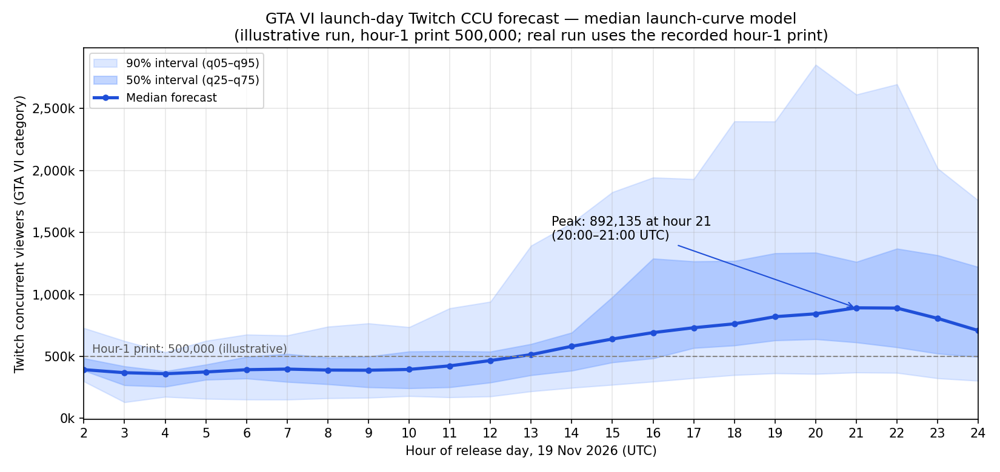

[](https://make.fun/c/gta6-twitch-ccu-forecast-01)
[](https://make.fun/c/gta6-twitch-ccu-forecast-01)
[](https://make.fun/c/gta6-twitch-ccu-forecast-01)

# GTA VI launch-day Twitch CCU forecast

Entry for the [make.fun](https://make.fun/c/gta6-twitch-ccu-forecast-01) competition
**"Forecast GTA VI's launch-day Twitch viewers hour by hour"** (`gta6-twitch-ccu-forecast-01`).

`main.ts` (Node 22, standard library only) reads a case file — hour 1's print plus 38–42
past big game launches' hourly Twitch curves — and writes one forecast file with five
quantiles (5/25/50/75/95%) of concurrent viewers for each of hours 2–24 of release day,
19 November 2026 (UTC).

## The model in one paragraph

For every past launch, take its release-day hourly curve as a ratio to its own hour-1
viewers (scale-free, in log space). Keep only launches whose hour 1 was already
post-unlock (hour-1 viewers ≥ 15% of that launch's release-day peak), weight console-only
launches ×3, and take the per-hour weighted median — lightly smoothed — as the forecast
median, with the spread from the same donor distribution. The resulting curve dips to
~0.72× hour 1 in the early-morning UTC trough (hour 4), climbs as Europe wakes and the
US unlocks (05:00/08:00 UTC), peaks at ~1.8× hour 1 in hours 21–22 (20:00–22:00 UTC:
Europe prime evening + US afternoon), then declines. See [MODEL.md](MODEL.md) for the
method, assumptions, and leave-one-out validation (pinball loss ≈ 0.23 on GTA-like
launches, vs ≈ 0.27 for the house baseline).

## Preview

Illustrative run with an assumed hour-1 print of 500,000 viewers (the real run uses the
recorded hour-1 print):



Median peak ≈ 892,000 viewers at hour 21 (20:00–21:00 UTC).

## Run it locally

```sh
mkdir -p out
MAKEFUN_INPUT_DIR=<kit>/input MAKEFUN_OUTPUT_DIR=out node main.ts
```

Reads every `<id>.in` in the input directory, writes `<id>.out` to the output directory.
Deterministic, offline, no dependencies; a single case runs in ~1 s (cap: 8 s).
